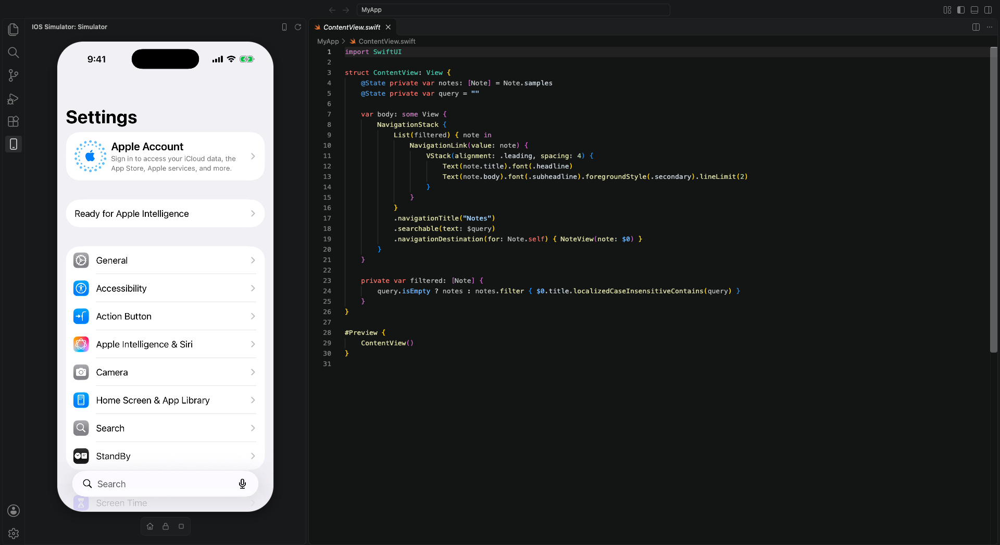

# iOS Simulator Viewer

See and drive a booted iOS simulator right inside VS Code, beside your code. Full-resolution video at up to 60 fps (decoded in hardware), live touch, trackpad scrolling and a hardware keyboard: it feels like Device Hub (Xcode 27's replacement for Simulator.app), without leaving the editor.



## Requirements

- **macOS** with **Xcode** and at least one iOS simulator.
- **idb-companion 1.7.8 or later** (the first with `sim-video` and Xcode 27 support):

  ```sh
  brew install idb-companion   # or: brew upgrade idb-companion
  ```

  The `idb` CLI (`fb-idb`) and Python are not needed.

## Using it

- **Open:** the phone icon in the activity bar ("iOS Simulator"), or run **Simulator: Show iOS Simulator**. Drag the view to the secondary side bar to keep it beside your code. Hiding the view stops everything; showing it again reconnects.
- **Title bar:** **Choose Simulator** (running ones first; choosing a shut-down one boots it) and **Reconnect**. The view's description shows which simulator it's on.
- **Under the screen:** Home, Lock and Stop. Stop ends the stream and input so nothing runs in the background; the simulator keeps running.
- **Touch:** press, drag and release act as a finger, live. Trackpad or wheel scrolling becomes a finger drag that follows the scroll.
- **Keyboard:** click the screen, then type. Keys go as physical keys, so Shift, held keys and arrows work as on a hardware keyboard. Cmd+V pastes the Mac's clipboard; Cmd+C and Cmd+X copy back to it; Cmd+A and Cmd+Z go to the simulator; other Cmd shortcuts stay with VS Code.

Works in Remote (SSH, containers) windows too: the extension always runs on your Mac, where the simulators are.

## How it works

The extension talks to two tools from idb-companion directly ([sim.js](sim.js)).

- **Screen:** `sim-video stream --encoding h264 --transport fmp4` writes the simulator's framebuffer as H.264 in fragmented MP4, one fragment per screen update. The webview decodes it with WebCodecs `VideoDecoder` (hardware, about 1 ms a frame) and draws it on a canvas. An idle screen sends no frames at all.
- **Input:** the extension starts its own `idb_companion` on a private Unix socket and keeps one gRPC `hid` stream open to it for touches, keys and buttons. The companion handles Xcode 27's simulator HID service.
- **Lifecycle:** one session per simulator shown. If VS Code quits unexpectedly, `sim-video` stops when its stdin closes and the companion exits 20 s after its HID stream drops.
- **Timing** (Xcode 27.2, measured): the simulator updates its screen about 90 ms after a touch moves (the same in Device Hub), and about 15 ms after a key. Encoding adds about 17 ms and decoding about 1 ms.

## Limits

- No pinch or multi-touch.
- iOS only. Rotation isn't handled.
- The rounded screen corners are one radius for every tall iPhone and none for other devices.

## Troubleshooting

- **"Needs idb-companion 1.7.8 or later"**: install or upgrade it with Homebrew (above), then click **Retry**.
- **"No simulator running"**: click **Choose Simulator** in the view to boot one.

## Development

```sh
code --extensionDevelopmentPath="$PWD"   # run from a clone of this repo
node check.js                            # with a simulator booted
```

`check.js` loads the extension with a fake VS Code and checks that it goes live with an H.264 decoder config and frames, that input reports no errors, that a page reload restarts only the video, that Stop leaves nothing running and Start comes back, and that Reload and closing the view leave exactly the processes they should. Set `SIM_VIEWER_STATS=/some/file.jsonl` before starting VS Code to log the page's decoded fps and decode time every 2 s.

## License

[MIT](LICENSE)
